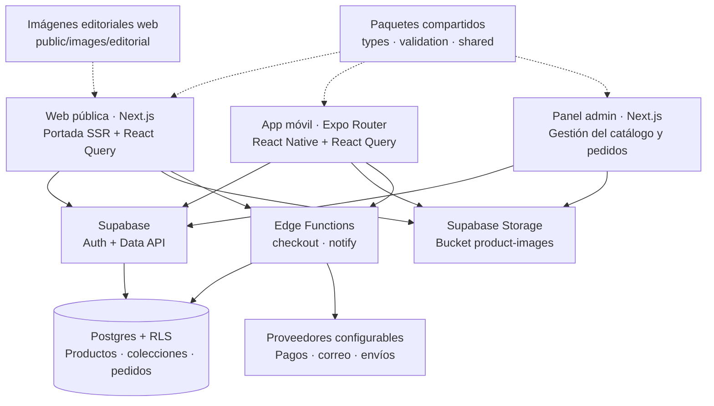

# ARCHITECTURE — Shopy

## Arquitectura actual · 15 de octubre de 2026

El proyecto tiene tres aplicaciones dentro de un monorepo npm workspaces. La web pública comparte backend y paquetes de dominio con la app móvil y el panel administrativo.

### Responsabilidades y recorridos

- **Web (`apps/web`)**: portada con productos iniciales leídos en servidor mediante clave pública y RLS. React Query gestiona catálogo, búsqueda y colecciones; la URL conserva filtros y orden. El carrito web se hidrata y persiste en `localStorage`, separado por usuario. Los puentes de pago de Next.js son rutas de servidor; sus credenciales no pertenecen al navegador.
- **Móvil (`apps/mobile`)**: Expo Router y React Query. El repositorio de catálogo puede usar Supabase o datos mock según configuración. Auth utiliza AsyncStorage; la sincronización de carrito autenticado usa el RPC `sync_my_cart`. La implementación móvil y la web no comparten un único proveedor de carrito.
- **Admin (`apps/admin`)**: gestión de productos, fotos, categorías, marcas, colecciones, descuentos, pedidos y envíos. Utiliza sesión Supabase y comprobación de rol, con RLS en el backend. No es una interfaz pública de compra.
- **Paquetes (`packages`)**: `types` contiene entidades y tipos de base de datos; `validation`, los esquemas Zod; `shared`, constantes y formato CLP. Los componentes visuales y clientes de datos siguen separados por aplicación.
- **Supabase (`supabase`)**: Postgres almacena el catálogo y las operaciones comerciales. RLS controla el acceso. Storage almacena fotos de prendas; la web resuelve sus rutas públicas. Las fotografías editoriales de modelos son archivos estáticos del proyecto web, no filas de productos.
- **Compra**: el navegador o móvil solicita cotización y checkout a la Edge Function. Las funciones y RPC validan precios, stock, reservas e idempotencia antes de crear o liquidar pedidos. Los proveedores de pagos, correo y despacho dependen de la configuración; la presencia de su código no prueba que estén activados en producción. `notify` atiende notificaciones internas; el webhook de pagos corresponde a `checkout`.
- **Tareas programadas**: las migraciones definen liberación de reservas cada minuto y actualización de tendencias cada 15 minutos. Este documento describe el código y no certifica la configuración remota de cron.

### Datos demo y límites de despliegue

El importador `supabase/seed/editorial-demo/import.mjs` carga únicamente su lote identificado mediante metadata, con stock cero y estado `SOLD`. El manifiesto fija identificadores y rutas, y permite repetir o retirar la carga sin reemplazar el inventario anterior. La web identifica las prendas demo y bloquea su compra. Las claves de escritura son exclusivas de scripts y procesos de servidor.

Esta arquitectura se ha contrastado con el repositorio. No implica haber verificado autenticación real, pagos reales ni todos los despliegues de las tres aplicaciones.

---

## Estructura y principios originales

- `apps/web`: Next.js + React Query (tienda pública).
- `apps/mobile`: Expo + Expo Router + TypeScript.
- `apps/admin`: Next.js + TypeScript.
- `packages/types`: entidades compartidas (Product, Order, Cart...).
- `packages/validation`: Zod (checkout, dirección, carrito).
- `packages/shared`: formato CLP, constantes (reserva 15 min, categorías iniciales).
- `supabase/`: migraciones, functions, seed (schema real en Fase 2).

Gestor: **npm workspaces**. Sin Turborepo/pnpm para no sobreingenierizar.
Si el repo crece se puede agregar Turborepo sin cambiar la estructura.

## Principios

1. Backend como fuente de verdad: disponibilidad, precios, stock, descuentos y
   estados de pedido se validan en Postgres/Edge Functions, nunca en el cliente.
2. Productos únicos con `stock = 1` pero schema admite `stock > 1` (a futuro).
3. Reserva temporal: `AVAILABLE -> RESERVED (15 min) -> SOLD`, expiración revierte.
4. Pagos/envíos/email como interfaces (`PaymentProvider`,
   `ShippingProvider`, `EmailProvider`) + mock en dev.
   Estado Fase 9: `EmailProvider` (mock/resend) con 7 templates ES y log
   idempotente (`order_notifications`); `ShippingProvider` manual contra
   `shipping_rates` + stubs Chilexpress/Starken env-gated.
5. RLS obligatoria; `service_role` jamás en cliente.
6. CLP como entero (sin decimales). `es-CL` para formato.
7. UI editorial minimalista con design tokens (Fase 3).

## Flujo de compra (resumen, detalle en PAYMENTS.md / DATABASE.md)

Carrito local persistente → checkout (dirección + despacho) →
reserva temporal en backend → `createPayment()` (mock/sandbox) →
webhook confirma → `PAID` → `PREPARING → SHIPPED → DELIVERED`.
