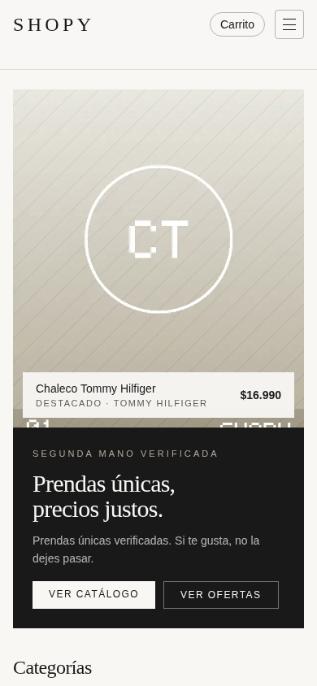
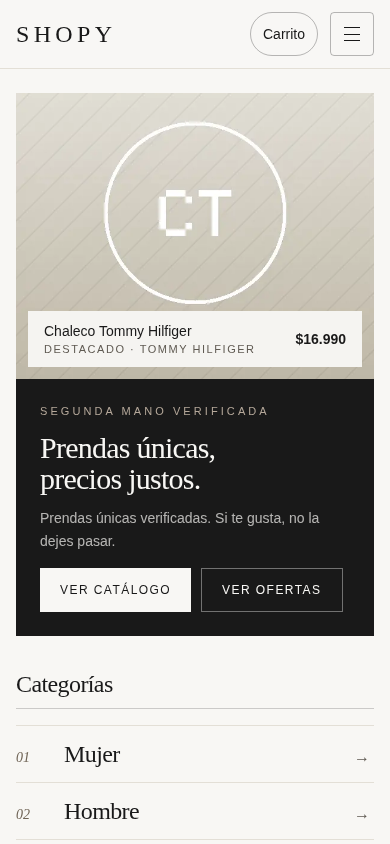
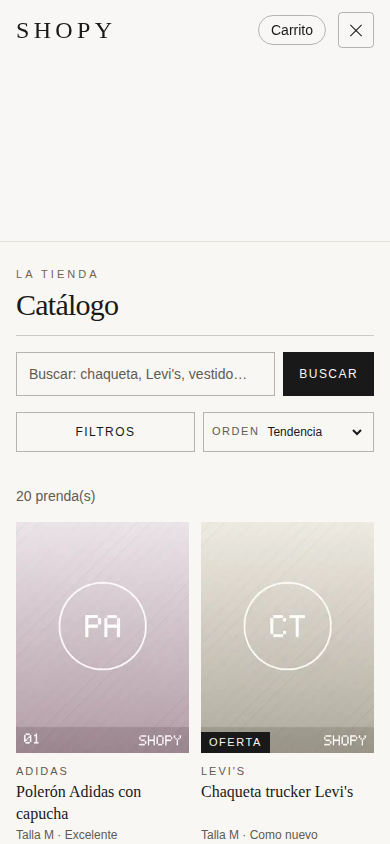
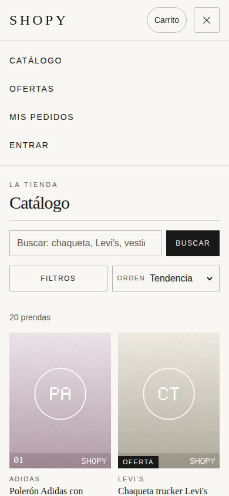
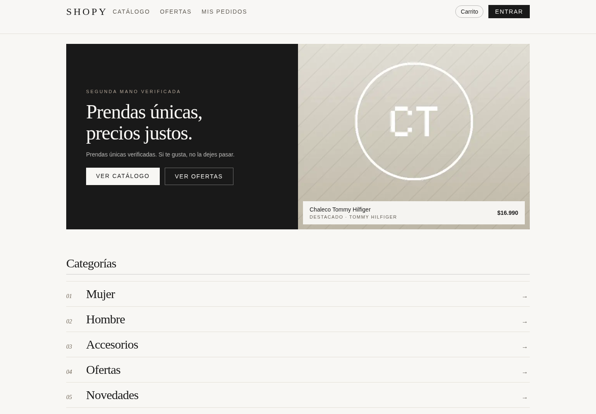
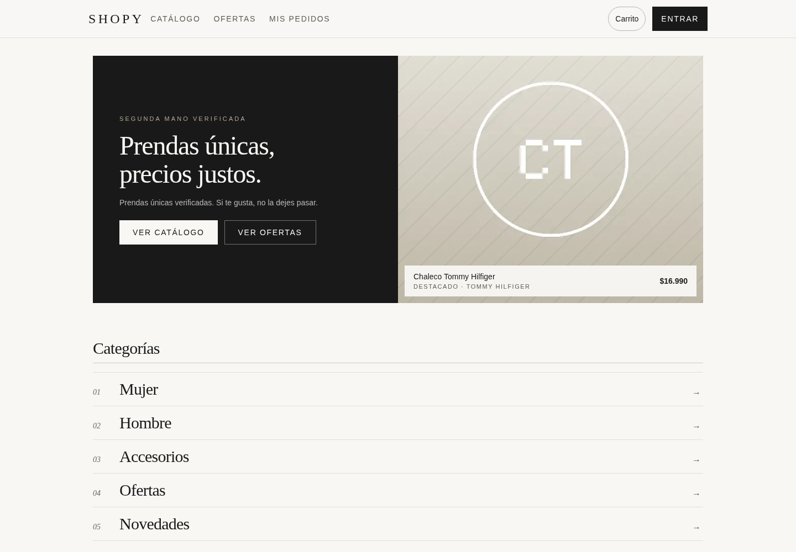

# Auditoría y mejoras de Shopy

Fecha: 15 de octubre de 2026. Sitio: https://shopy-web-six.vercel.app. Repositorio: `Brocoleo/Shoppy`, rama `master`.

## Alcance y método

Se inspeccionaron las instrucciones del proyecto, el código de `apps/web`, los paquetes compartidos y los recorridos de catálogo, ficha, carrito, acceso, pedidos, rastreo y dirección/despacho del checkout. La aplicación es una tienda chilena de ropa de segunda mano, con Next.js 16.3.6, React, Tailwind 4, TanStack Query y Supabase.

El entorno real usa `/home/leandro/Documentos/ChatGPT/React Native/Shoppy`; la ruta de macOS del contexto no existe aquí. Se preservaron los numerosos cambios previos del usuario. Primero se trabajó sobre una copia temporal, después se aplicaron únicamente los 22 archivos de esta intervención, comprobando sus hashes para evitar sobrescribir cambios concurrentes. La fuente final coincide byte por byte con la compilación de producción local verificada.

Chrome/Playwright permitió inspeccionar el despliegue público y la versión modificada, con capturas a 390 × 844 y 1440 × 1000. Se añadieron comprobaciones de adaptación a 320 y 768 px. La primera consulta web y el acceso de red restringido fallaron; el acceso de red autorizado permitió continuar con la web pública. No fue un fallo de disponibilidad confirmado del sitio.

## Hallazgos priorizados

| Prioridad | Hallazgo y evidencia | Solución |
| --- | --- | --- |
| P1 | Menú y filtros móviles invisibles aunque `aria-expanded` era verdadero. Chrome confirmó `visibility: collapse` heredada. La clase personalizada `collapse` colisionaba con Tailwind. | Renombrar a `disclosure` y corregir la envoltura del menú para que tampoco reserve espacio cerrado. |
| P1 | La ficha descartaba explícitamente todas las fotos marcadas como defectos y mostraba solo una foto normal. Confirmado en código; la prenda de cuero tiene fotos de detalles. | Galería con botones nativos, estado seleccionado y descripción anunciada de las fotos del estado de la prenda. |
| P2 | Filtros duplicados en estado local y URL: los cambios de URL/historial podían dejar controles y resultados desincronizados. | Usar la URL como fuente de verdad; comprobar actualización y regreso del navegador. |
| P2 | Colección sin productos: consulta dependiente deshabilitada, pero `isPending` mantenía el mensaje de carga indefinidamente. Hallazgo de código, escenario reproducido con respuesta controlada. | Mostrar el estado vacío existente cuando no hay IDs. |
| P2 | El formulario de dirección no conectaba el `ref` de React Hook Form: no enfocaba el primer campo inválido. Los mensajes tampoco estaban vinculados mediante ARIA. | Conectar ref, nombre, autocompletado, `aria-invalid` y `aria-describedby`; anunciar errores. |
| P2 | Menú sin cierre con Escape, filtros sin retorno de foco al cerrar y controles de 30–40 px en cabecera/filtros/carrito. | Escape y foco restaurado; ampliar los controles principales a 44 px. |
| P2 | Selectores de despacho/pago usaban botones con `role="radio"`, sin el comportamiento de teclado de radios. | Usar radios nativos con etiquetas. Se verificaron selección y flechas en despacho. |
| P2 | Carrito vacío y pedidos sin sesión carecían de `h1`. Acciones de pedidos podían no caber a 320 px. | Encabezados semánticos y acciones con ajuste de línea. |
| P2 | La portada esperaba todas las consultas principales y un error reemplazaba todo su contenido. Además se repetían consultas de categorías/marcas. | Portada progresiva, esqueletos y errores por sección; compartir las solicitudes de taxonomía concurrentes. |
| P2 | Imágenes de la primera fila del catálogo se cargaban de forma diferida pese a estar en pantalla; Next avisaba sobre LCP. | Carga inmediata de las primeras cuatro tarjetas del catálogo/colecciones; mantener carga diferida en las demás. |
| P3 | Mismo título en catálogo, acceso, carrito, checkout y pedidos; mensajes de error exponían rutas de configuración. | Metadatos por sección, noindex en páginas transaccionales/personales y mensajes orientados a quien compra. |

## Decisiones visuales

Se conservan la paleta marfil/carbón, los tipos serif/sans del sistema, el tono editorial, los precios CLP y la estructura de las secciones. Se reduce la altura de la imagen de portada en móvil para que texto y acciones aparezcan antes; se amplían las acciones y se mantiene el pie al final de las páginas cortas. Estas decisiones son ajustes de diseño, no infracciones normativas ni mejoras de conversión demostradas.

Las imágenes del catálogo son los placeholders existentes. No se inventaron fotografías, testimonios, métricas ni contenido comercial. Su sustitución por fotos reales queda pendiente de disponer de esos activos.

## Verificación ejecutada

- `npm --workspace apps/web run build -- --webpack`: **pasa**, compilación optimizada, TypeScript y generación de 11 páginas estáticas. Se ejecutó en la copia temporal, con el código final idéntico al repositorio. No se desplegó.
- `next typegen apps/web` y `npm run web:typecheck` en el repositorio final: **pasan**. Fue necesario regenerar tipos porque coexistían cachés antiguas de desarrollo y producción.
- `npm run test:beta`: **pasa**, 3 archivos de pruebas, 0 fallos. Es la suite existente, no una prueba de pago real.
- `npm --workspace apps/web run lint`: queda **1 error previo**, `react-hooks/set-state-in-effect` en `src/lib/cart.tsx:55`. La ejecución original tenía dos errores y una advertencia. Se corrigieron el efecto del checkout y la navegación de rastreo; no se reestructuró el proveedor del carrito.
- 18 comprobaciones funcionales sobre producción local: menú visible, Escape/foco, filtros, limpieza, búsqueda sin resultados, fotos de defectos, carrito y persistencia al recargar, validación de dirección y primer error enfocado, paso a despacho, ajuste de pedidos a 320 px, rastreo requerido, salto al contenido y ausencia de excepciones de navegador en esa ejecución.
- Comprobaciones adicionales: URL/historial coherentes; cuatro tarifas de despacho cargadas; selección y flechas en radios; ausencia de desbordamiento en catálogo/acceso/pedidos a 320, 768 y 1440 px; movimiento reducido respetado.
- Escenarios controlados con intercepción **solo en el navegador local**: colección vacía y error 503 de productos con portada conservada y botones de reintento. No se alteró Supabase.
- Axe-core 4.10.3, reglas WCAG A/AA etiquetadas hasta WCAG 2.2: **0 infracciones detectadas en 10 vistas finales** (cinco páginas en dos tamaños), y 0 en despacho. También se revisó la versión pública. Esto no certifica conformidad completa ni sustituye las pruebas manuales.
- Solicitudes observadas de categorías/marcas en una carga nueva de portada: **6 antes, 2 después** en la ejecución guardada. Una ejecución anterior produjo 5 antes; la concurrencia explica esa variación. No se atribuyen porcentajes de velocidad ni resultados de Core Web Vitals a esta medición.

## Comparación visual

Antes: despliegue público. Después: compilación optimizada ejecutada localmente. Mismos tamaños y contenido existente. Para capturas completas se recorrió la página y se forzó únicamente durante la captura el pintado de tarjetas con `content-visibility:auto`; así se evitan huecos que genera la captura de contenido fuera de pantalla. Esa intervención de captura no se incluyó en el código de la tienda.

### Portada móvil

| Antes | Después |
| --- | --- |
|  |  |

### Menú móvil

| Antes: expandido pero invisible | Después |
| --- | --- |
|  |  |

### Portada de escritorio

| Antes | Después |
| --- | --- |
|  |  |

También se guardan capturas completas de catálogo, acceso, pedidos y ficha, además del estado de error y despacho.

## Límites y pendientes

No se crearon cuentas, pedidos ni pagos. No se verificaron historial autenticado, correos, proveedores de pago, retorno de pagos, despachos reales, dispositivos físicos ni lectores de pantalla reales. Se verificó teclado con Chrome y se inspeccionó semántica con axe. No se ejecutó Lighthouse ni se midieron Core Web Vitals de campo; no se afirma una mejora de latencia o de puntuación. El despliegue público sigue con el código anterior hasta que se autorice una publicación.

El error previo de ESLint del carrito queda identificado arriba. Los títulos y metadatos específicos de cada producto y colección siguen siendo genéricos; no se añadió una capa de renderizado/datos nueva para resolverlos en esta intervención.

Se aplicaron Caveman y Ponytail. RTK no estaba disponible en PATH ni en las ubicaciones habituales revisadas; se leyó la copia Linux de RTK.md y se ejecutaron comandos directos. Headroom no pudo verificarse como integración disponible; no se modificaron proveedor ni autenticación.

## Evidencia y repetición

`evidence/` contiene resultados JSON, logs y capturas. `changes.patch` separa esta intervención del trabajo previo. `verify.cjs` conserva las comprobaciones funcionales de esta auditoría; presupone los productos y el catálogo de prueba existentes al ejecutar la auditoría. Necesita Playwright y Chrome disponibles fuera de las dependencias de la aplicación.

```sh
PLAYWRIGHT_MODULE=/ruta/a/playwright CHROME_PATH=/ruta/a/chrome AUDIT_URL=http://127.0.0.1:3107 node docs/auditoria-web-2026-10-15/verify.cjs
```

No se añadieron dependencias al proyecto, no se creó ningún commit y no se publicó en producción.


## Actualización: ronda 3

Portada, catálogo y ficha rediseñados, carga inicial desde servidor y carrito verificado con cambios de sesión simulados y fallos de almacenamiento.

[Informe, capturas comparativas, pruebas y rendimiento de la ronda 3](evidence/ronda3/README.md).


## Actualización: ronda 4

Dirección editorial A con fotografías generadas de modelos, ocho prendas demo no comprables importadas a Supabase, animaciones y comparativas con el mismo catálogo.

[Informe y evidencias de la ronda 4](evidence/ronda4/README.md).


## Actualización: ronda 5

Cabeceras editoriales de catálogo y ofertas, novedades por defecto, pruebas de listados y diagrama de arquitectura.

[Informe, capturas y pruebas de la ronda 5](evidence/ronda5/README.md).
