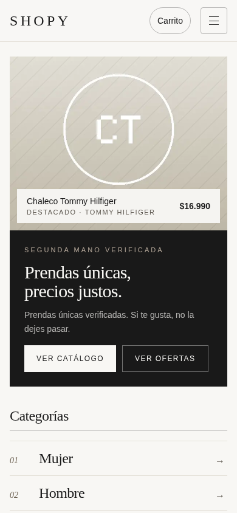
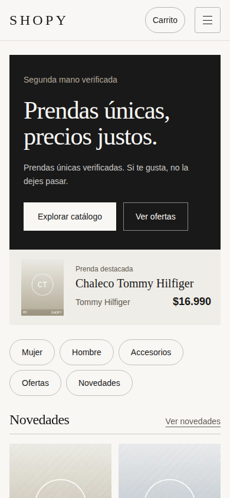
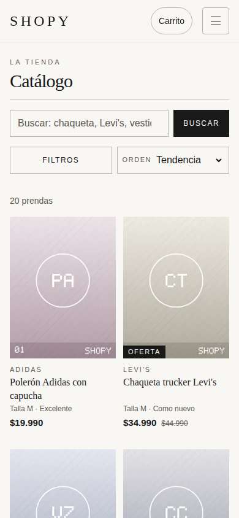
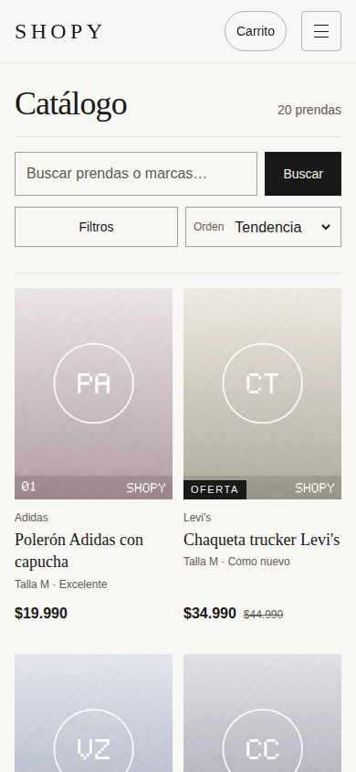
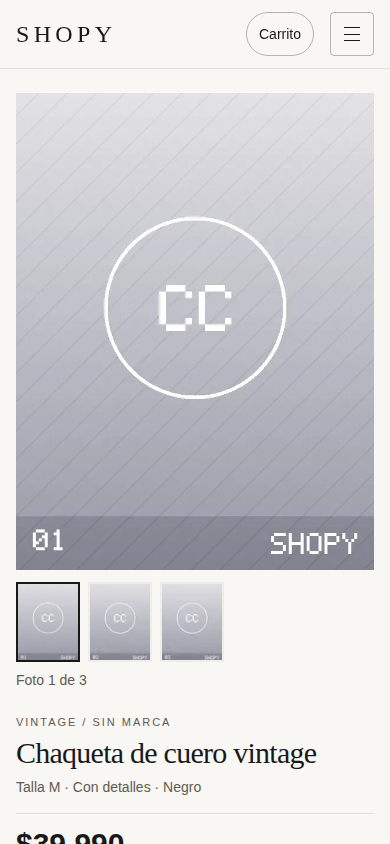
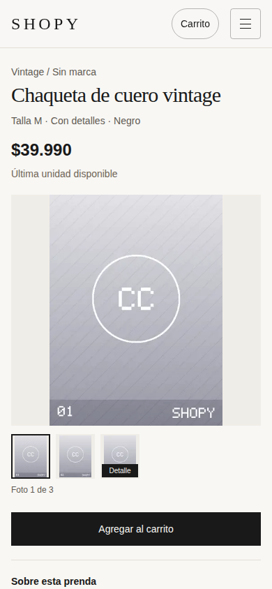
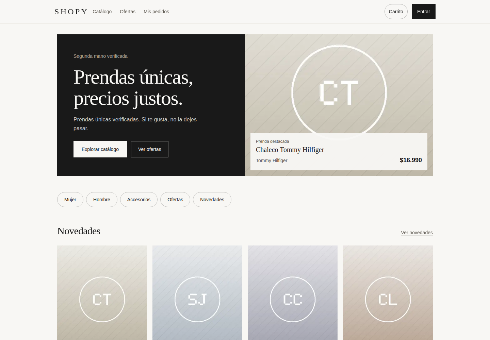

# Ronda 3: rediseño y recorrido de compra

15 de octubre de 2026. Repositorio `Brocoleo/Shoppy`, rama `master`. Sin commit ni publicación. Esta ronda parte del estado local de la ronda 2, incluidos sus cambios sin confirmar; no de la versión antigua publicada en Vercel.

## Resultado y decisiones

La portada móvil presenta primero mensaje y acción de explorar. La prenda destacada pasa a una franja compacta; las categorías se conservan como enlaces sin numeración y las novedades aparecen antes. En escritorio se conserva la composición editorial de dos columnas, marfil/carbón y las familias tipográficas existentes.

El catálogo reúne búsqueda, filtros y ordenación. Los filtros activos muestran sus nombres y permiten quitar uno sin perder los demás; al quitar un filtro con teclado, el foco vuelve a búsqueda después de actualizar la URL. Las tarjetas dan más jerarquía al nombre/precio, reducen mayúsculas y alinean los precios sin reservar siempre dos líneas para el título.

La ficha móvil presenta nombre, precio, talla, estado y disponibilidad antes de la galería. La imagen completa sustituye al recorte; las fotos de defectos tienen miniatura identificada y descripción anunciada. El botón de compra queda antes de la descripción. En escritorio, galería a la izquierda e información a la derecha.

No se inventaron fotografías ni contenido comercial. Los placeholders existentes siguen limitando el acabado fotográfico.

## Correcciones técnicas

- La entrada de portada ahora obtiene las ocho novedades iniciales en servidor mediante la clave pública anon, con las mismas restricciones de publicación y archivo. No utiliza claves privilegiadas. Las solicitudes usan `no-store`, la ruta es dinámica y la lectura tiene un límite de 2,5 segundos.
- Se comparte el mapeo de productos entre servidor y cliente. React Query recibe los datos iniciales y no repite inmediatamente la consulta. Categorías, tendencias, colecciones e interacciones mantienen su carga cliente. No se añadió caché persistente de precios ni disponibilidad.
- Si falla esa primera lectura, los datos iniciales quedan indefinidos: la portada conserva mensaje/acciones y React Query puede recuperar las prendas. No se convierte el fallo en un catálogo vacío. Se comprobó con un 503 simulado únicamente en otro proceso servidor local.
- El carrito parte del mismo estado en servidor y navegador. Lee almacenamiento después del montaje y persiste solo cuando ha resuelto el dueño correspondiente. Se eliminaron escrituras/borrados durante el render; se mantienen claves y fusión por cantidad máxima. El campo adicional `ready` permite a ficha, carrito y checkout esperar la hidratación sin mostrar estados vacíos incorrectos.
- Una prueba adicional reprodujo pérdida de datos si `getItem` fallaba pero `setItem` funcionaba. Ahora una lectura fallida impide sobrescribir datos desconocidos y el carrito sigue funcionando en memoria. Se conserva el origen de una fusión si no puede guardarse correctamente el destino.
- Los desplegables usan una capa CSS que permite a `sm:hidden`/`md:hidden` prevalecer; los filtros abiertos en móvil no se duplican al ampliar la pantalla. Axe detectó un nombre ARIA sin rol en el esqueleto: se corrigió con un estado semántico.
- Se eliminó la duplicación real `Shopy | Shopy` que producía la combinación entre títulos específicos y la plantilla raíz. Se conservaron los metadatos específicos existentes.

No se cambiaron base de datos, pagos, autenticación, dependencias, lockfile ni configuración de despliegue.

## Comparación visual

Antes y después son compilaciones locales de producción, con el mismo catálogo existente y tamaños de 390 × 844 y 1440 × 1000. Se esperó a productos e imágenes visibles cargados. Las capturas completas fuerzan el pintado de tarjetas fuera de pantalla únicamente durante la captura para evitar huecos de `content-visibility`; ese cambio no está en la aplicación.

### Portada móvil

| Antes | Después |
| --- | --- |
|  |  |

### Catálogo móvil

| Antes | Después |
| --- | --- |
|  |  |

### Ficha móvil

| Antes | Después |
| --- | --- |
|  |  |

### Portada de escritorio

| Antes | Después |
| --- | --- |
|  |  |

También se guardan capturas completas de las tres pantallas en ambos tamaños, menú/filtros abiertos y portada sin JavaScript.

## Verificación

- Build optimizado de Next.js: pasa. Ejecutado en copia aislada; los 18 archivos entregados se comprueban idénticos a la fuente compilada.
- TypeScript, ESLint y `git diff --check` del repositorio final: pasan.
- Pruebas puras: 9 existentes del carrito y 2 nuevas del mapeo compartido, ejecutadas directamente con Node. La suite beta existente también pasa; su salida ampliada se conserva.
- 28 comprobaciones de recorridos/adaptación: menú, Escape y foco, filtros individuales, búsqueda vacía, historial, foto de defectos, ficha antes de galería, carrito, primer error de dirección, paso a despacho, radios con flechas, salto al contenido y movimiento reducido. Sin desbordamiento en cinco pantallas a 320, 768 y 1440 px.
- 14 comprobaciones del carrito real en navegador: hidratación con datos persistidos sin discrepancias, fusión guest/usuario, cierre/cambio entre dos usuarios, recarga, ausencia de escrituras transitorias vacías/ajenas, saneamiento y almacenamiento bloqueado. **Todos los endpoints de autenticación se interceptaron**; no se crearon cuentas ni sesiones reales.
- Regresión adicional: fallo de lectura con escritura disponible. Se guardan evidencia del fallo anterior y resultado correcto posterior. El contenido previamente guardado permanece intacto mientras las nuevas operaciones viven en memoria.
- Cinco comprobaciones adicionales de calidad: ocho novedades y recurso prioritario en HTML sin JavaScript; consulta inicial no duplicada en navegador; adaptación de filtros abiertos a escritorio; foco al quitar la búsqueda mediante teclado.
- Axe-core 4.10.3: 0 infracciones detectadas en 11 vistas finales, incluidas portada, catálogo, ficha, carrito, acceso y menú/filtros abiertos. Se usaron etiquetas WCAG A/AA hasta 2.2. No es una certificación completa de accesibilidad.
- Recuperación de lectura inicial: 503 simulado en un proceso local separado; contenido estático conservado y recuperación de novedades en cliente comprobada.

### Qué funciona sin JavaScript

La respuesta de portada contiene su mensaje, enlaces, fotografía destacada y ocho novedades con nombres, precios e imágenes. No se afirma que toda la tienda funcione sin JavaScript: categorías/tendencias/ofertas cargadas en cliente, menú móvil, filtros, galería interactiva, sesión, carrito y checkout siguen dependiendo de él. `results/initial-home.html` conserva la respuesta inicial.

## Rendimiento: tres ejecuciones por versión

Lighthouse 13.5.0, mismo puerto local y preset móvil, latencia simulada de 150 ms, CPU ×4 y las mismas opciones. Las series se ejecutaron secuencialmente y sin otras pruebas de navegador simultáneas. Los JSON y las trazas comprimidas se conservan.

| Mediana | Antes | Después |
| --- | ---: | ---: |
| Puntuación de rendimiento | {{BEFORE_SCORE}} | {{AFTER_SCORE}} |
| LCP | {{BEFORE_LCP}} s | {{AFTER_LCP}} s |
| TBT | {{BEFORE_TBT}} ms | {{AFTER_TBT}} ms |
| CLS | {{BEFORE_CLS}} | {{AFTER_CLS}} |

{{PERFORMANCE_CONCLUSION}}

El elemento LCP cambia de la fotografía grande al titular por la nueva composición móvil. La mejora observada no se atribuye exclusivamente al servidor. La lectura servidor añade trabajo al tiempo de respuesta frente a la portada estática anterior; adelanta los datos y elimina la espera cliente para descubrir la imagen. Se guardan las tres muestras, su mediana y el desglose de Lighthouse. Son mediciones de laboratorio local, no datos de campo ni una garantía de comportamiento en Vercel o dispositivos reales.

## Límites y reproducción

No se probaron cuentas reales, compras, pagos, retornos de pago, lectores de pantalla reales ni dispositivos físicos. No se modificaron secretos ni se publicó. No se resolvió la falta de fotografías reales.

Durante las navegaciones automatizadas Next.js registró mensajes `The destination stream closed early`. No se detectaron excepciones de navegador ni un fallo visible asociado; no se declara que el log del servidor esté completamente libre de errores. Su registro se conserva para seguimiento.

`changes.patch` contiene únicamente esta ronda, respecto del estado inicial del usuario. `scripts/` conserva verificaciones de navegador y Lighthouse. Requieren Chrome, Playwright y axe disponibles como herramientas externas; no se añadieron al proyecto. Las comprobaciones presuponen el catálogo de prueba existente (incluida la prenda de cuero y los 20 productos).

Desde la raíz del repositorio:

```sh
npm --workspace apps/web run build -- --webpack
node_modules/.bin/next start apps/web --hostname 127.0.0.1 --port 3113
```

En otra terminal, configurar `PLAYWRIGHT_MODULE` con la ruta a Playwright, `CHROME_PATH` con la ruta a Chrome, `AXE_PATH` con axe.min.js y, opcionalmente, `AUDIT_URL`/`AUDIT_OUTPUT`. Ejecutar `node docs/auditoria-web-2026-10-15/evidence/ronda3/scripts/flows.cjs`, `cart-integration.cjs`, `storage-read-failure.cjs` o `quality.cjs` desde ese mismo directorio de scripts según la comprobación deseada. Para Lighthouse, configurar `LIGHTHOUSE_CLI` con `lighthouse/cli/index.js` y ejecutar `sh .../scripts/lighthouse.sh after`. Las trazas `.json.gz` se pueden descomprimir sin pérdida.

La prueba de recuperación usa una segunda instancia en el puerto 3116 con `NODE_OPTIONS="--require /ruta/a/scripts/fail-initial.cjs"`; ese interceptor es exclusivamente de pruebas y no forma parte de la aplicación.

Se aplicaron las guías de frontend, UI/UX, Caveman y Ponytail. RTK y Headroom no estuvieron disponibles como integraciones verificadas; no se cambió proveedor ni autenticación del agente.
