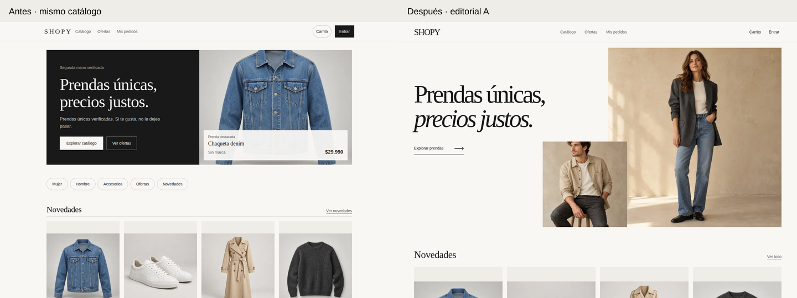
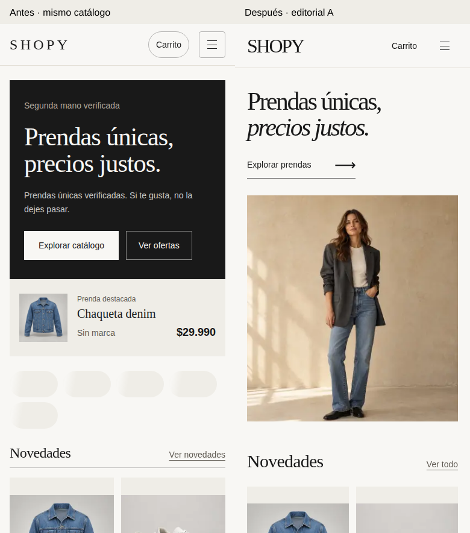

# Ronda 4 · Editorial A con fotografías y catálogo demo

Implementación de la propuesta visual elegida, sobre el trabajo anterior. Sin commits ni despliegue. La importación de datos remotos sí se ejecutó con autorización expresa.

## Resultado visual

- Portada marfil con titular de gran escala, segunda línea en cursiva y enlace de exploración visible.
- Fotografía principal de una modelo adulta y retrato secundario superpuesto en escritorio; composición de una sola imagen en móvil, con texto antes de la fotografía.
- Diez recursos originales generados por separado con `image_gen.imagegen`: dos modelos y ocho prendas. No se recortaron fotografías de la maqueta. Archivos convertidos a WebP; principales de 74.560 y 88.306 bytes, prendas entre 19.714 y 128.838 bytes.
- Entrada coordinada de titular, acción y fotos, hasta 700 ms; animaciones desactivadas con movimiento reducido. Se conservan revelados existentes y transiciones de interacción.
- Novedades inmediatamente después de portada, categorías tipográficas y controles de cabecera más discretos. Catálogo, filtros, galería, carrito y checkout conservados.
- Identificación de producto demo y precio ilustrativo en tarjetas y ficha; botón de compra desactivado por identificación demo y por stock cero.

Las comparativas anteriores utilizan el mismo catálogo remoto de 28 prendas en ambas versiones. Los archivos `before-*` sin `same-data` corresponden al estado inicial con 20 prendas. También se conservaron las capturas completas de portada, catálogo y ficha a 390 y 1440 px.

## Datos remotos

Proyecto comprobado: `evzlqwiipdjgtrqjlwba`. Se utilizó la credencial de escritura proporcionada en `supabase/.env`, que está ignorado por Git. No se copió el archivo ni la clave al informe.

Se añadieron ocho filas en `products` y ocho en `product_images`, más ocho objetos en el bucket existente `product-images`. Los modelos se sirven como recursos editoriales locales de la web, sin tablas nuevas.

Cada producto nuevo usa `metadata.demo=true`, `metadata.batch=editorial-a-20261015`, descripción explícita de demostración, stock 0 y disponibilidad `SOLD`. No se atribuyeron marcas a las prendas generadas. Tallas, precios y estado son ilustrativos. La selección inicial de portada incluye las ocho prendas demo desde HTML.

La importación se ejecutó tres veces: quedaron ocho productos demo y ocho imágenes, sin duplicados. Los identificadores y rutas figuran en [demo-manifest.json](demo-manifest.json); la última ejecución quedó registrada en [import-record.json](import-record.json).

Los campos comerciales, stock, disponibilidad, descripciones e imágenes de los 20 productos anteriores se conservaron. La comparación completa detectó cambios únicamente en `updated_at` y dos valores de `trending_score`, a las 21:45 UTC. Coinciden con el refresco de tendencias cada 15 minutos definido en la migración existente; esto no constituye una comprobación independiente de la configuración cron remota. Se conservaron las diferencias en `results/remote-maintenance-differences.json`.

No hubo cambios de esquema, RLS, autenticación, pedidos o pagos.

## Verificación

- Compilación Next.js de producción: correcta. TypeScript web, ESLint web y ESLint global: correctos. Se configuró el contexto Node/Chrome de los scripts históricos de auditoría en ESLint; no se excluyeron sus comprobaciones de variables no definidas.
- Mapeo de productos: 3 pruebas, incluyendo identificación estricta de demo. Funciones del carrito: 9 pruebas. `npm run test:beta`: 3 archivos aprobados; el ejecutor agrupa sus pruebas internas, sin atribuirle un recuento más detallado.
- Navegador Chrome mediante Playwright: 28 comprobaciones del recorrido existente, 13 específicas del diseño y catálogo demo, y 5 adicionales de calidad.
- Menú y filtros con Escape y retorno del foco, historial, búsqueda vacía, galería con detalle de defectos, añadido de una prenda anterior al carrito, validación del formulario y paso a despacho con radios por teclado. No se completaron pedidos.
- Sin desbordamientos en portada, catálogo, ficha, login y carrito a 320, 768 y 1440 px. Capturas comparativas a 390 y 1440 px. En escritorio, la foto secundaria no tapa titular ni acción; en móvil no ocupa espacio.
- Axe: cero infracciones detectadas en 11 vistas de la auditoría general y en la ficha demo. No equivale a una auditoría manual completa con lectores de pantalla.
- HTML sin JavaScript: contiene novedades y fotografía principal con precarga. La principal no usa carga diferida y la secundaria sí. No se repite inmediatamente la consulta inicial de novedades en el navegador.
- Movimiento reducido comprobado por navegador, así como presencia de la animación en modo normal.
- Sin excepciones JavaScript no capturadas en el recorrido verificado. El servidor Next registró `The destination stream closed early` durante cancelaciones de navegación automatizada; se conserva el log y no se afirma que esté libre de errores.

## Rendimiento móvil

Lighthouse 13.5, compilación de producción, Chrome local, condiciones predeterminadas móviles de la misma herramienta. Tres ejecuciones antes y tres después, con el mismo catálogo de 28 productos. Informes y trazas comprimidas disponibles en `results/`.

| Mediana | Antes | Después |
|---|---:|---:|
| Puntuación | 84 | 81 |
| LCP | 1,68 s | 1,91 s |
| TBT | 606 ms | 518 ms |
| CLS | 0 | 0 |

La variación es considerable: puntuaciones anteriores 88/75/84 y posteriores 90/81/77. LCP posterior entre 1,46 y 2,15 s. La serie final no demuestra una mejora de rendimiento: la puntuación mediana baja 3 puntos y el LCP sube unos 0,24 s; TBT baja y CLS permanece en cero. No se atribuye una mejora causal garantizada al rediseño ni se extrapola a datos de campo. Las capturas finalizaron antes de iniciar las series finales. Las series intermedias se conservan por separado.

El elemento LCP cambia: antes es el titular; después es el título Novedades en las tres ejecuciones finales. No son mediciones del mismo elemento. La fotografía principal se descubre desde el HTML inicial; este criterio se verificó directamente, independientemente de Lighthouse.

La primera pareja de series con 28 productos mostró medianas diferentes (82/93 puntos, LCP 2,02/1,99 s); se archivó en `results/intermediate-performance/` al fijar el orden de las prendas. La referencia inicial terminó correctamente y la sesión se interrumpió antes de iniciar la serie posterior; esa serie se completó en una sesión nueva con idénticos parámetros. Se informa la pareja final sin escoger la más favorable.

La primera serie `lighthouse-before-*` corresponde al catálogo original de 20 productos y se conserva como referencia adicional, no como comparativa principal.

## Recursos y reproducción

- Fotografías de modelos: `apps/web/public/images/editorial/`.
- Prendas, manifiesto e importador: `supabase/seed/editorial-demo/`.
- Procedencia y prompts de las diez imágenes: [asset-provenance.json](asset-provenance.json).
- Cambios de código de esta ronda frente al inicio: [changes.patch](changes.patch). Los archivos nuevos del importador y las imágenes están en sus directorios del proyecto.
- Scripts de navegador y medición: `scripts/`. Son registros del entorno de esta sesión, con rutas locales a Playwright, axe, Chrome y `/tmp/shopy-r4`; requieren ajustar esas rutas si se reproducen en otra máquina.

## Límites

Las imágenes son generadas y las prendas demo no son inventario real ni pueden comprarse. No se crearon cuentas, pedidos ni pagos reales. No se probaron dispositivos físicos, autenticación real ni lectores de pantalla. La función de retirada del lote está preparada pero no se ejecutó, para conservar los datos solicitados. La web desplegada no recibió el diseño nuevo; los registros demo sí están en Supabase y pueden ser visibles para los clientes existentes.
